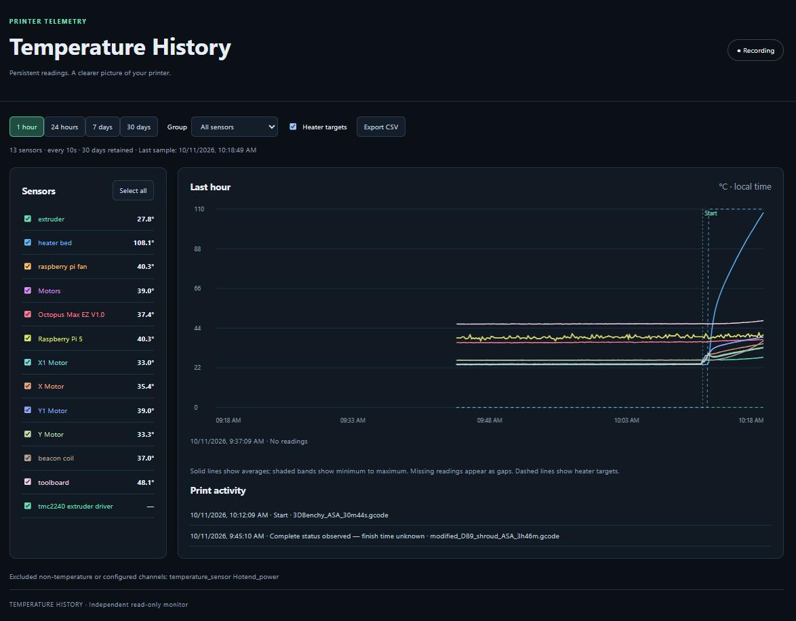

# Temperature History

A standalone temperature-history monitor for Klipper printers using Moonraker.



## Project status

Initial implementation with a persistent recorder, dashboard, and Git-based Linux
installer. Requires Python 3.9+; no third-party Python packages or external web
assets are needed. This is not yet a tagged stable release.

## Purpose

Keep temperature history over several days, including when the browser is closed,
without adding code to a printer control UI or a Nevermore project. The setup will
run independently on the printer's Linux host or another always-on Linux machine.

## Features

- Discover temperature sensors exposed by Moonraker, including heaters,
  temperature sensors, temperature fans, and supported temperature monitors.
- Record temperatures every 10 seconds in a persistent SQLite database.
- Retain 30 days of history by default, with configurable sampling and retention.
- Provide live readings and 1-hour, 24-hour, 7-day, and 30-day chart views.
- Select sensors and group heaters, motors, and electronics for readable charts.
- Create named custom groups with any combination of channels, shared across browsers.
- Remove channels and their recorded data after six hours without a valid temperature
  (configurable), including channels that were renamed or removed from the printer.
- A Nevermore group appears when recorded sensors include Nevermore/StealthMax
  names, `SM_*` channels (including `_SM_*`), or `BME_IN` and `BME_OUT`.
  These remain available under All sensors and are excluded from
  Electronics & other. Grouping uses existing Moonraker telemetry only.
- Record heater targets and print-state changes alongside temperatures.
- Mark starts, finishes, pauses, resumes, cancellations, and errors on the graph.
- Show gaps for missing or disconnected sensors rather than inventing readings.
- Export recorded data as CSV.
- Run as its own systemd service and serve a dashboard on a configurable port.
- Preserve spikes with minimum/maximum bands in aggregated long-range charts.

## Design boundaries

The monitor reads telemetry from Moonraker. It does not send G-code, change
heater targets, control fans, or modify printer configuration. It will have its own
configuration, database, service, and web assets. It does not depend on or modify
Nevermore software. Any future integration with an additional telemetry source
will be optional.

Not every value presented through a Klipper temperature interface is a temperature.
Power sensors and other non-temperature telemetry must be identified and labeled
with their actual units before appearing in charts.

## Configuration

Copy `config.example.json` to `config.local.json`. The installer does this if local
settings do not already exist. Database paths are relative to the configuration
file. Restart the service after editing settings.

| Setting | Default | Purpose |
| --- | --- | --- |
| `moonraker_url` | `http://127.0.0.1:7125` | Moonraker HTTP endpoint |
| `bind` | `0.0.0.0` in example | Dashboard listen address |
| `port` | `7132` | Dashboard port |
| `sample_seconds` | `10` | Sample interval, minimum 1 second |
| `retention_days` | `30` | Retention, maximum 365 days |
| `stale_channel_hours` | `6` | Delete channels with no valid temperature for this many hours; `0` disables cleanup |
| `database` | `data/history.sqlite3` | Persistent SQLite file |
| `api_key_env` | `MOONRAKER_API_KEY` | Environment variable containing API key |
| `exclude_sensors` | `[]` | Full Moonraker object names to exclude |
| `include_nonstandard_sensors` | `[]` | Override exclusions only for verified temperature channels |

For authenticated Moonraker, set `MOONRAKER_API_KEY` in the service's optional
`.env` file (`MOONRAKER_API_KEY=your-key`, permission `600`), or export it in your
shell for manual runs. The key stays on the recorder host and never reaches the
browser. Local settings, credentials, databases, and logs are ignored by Git.

Klipper sometimes exposes non-temperature values through temperature interfaces.
`HOT_P`, `HOT_V`, `HOT_I`, SGP gas-sensor types (including SGP40), and `plot_voc`
channels are automatically excluded. Gas/VOC readings cannot be enabled through
`include_nonstandard_sensors`. BME temperature is recorded; pressure and humidity
fields are ignored. Previously recorded excluded channels are hidden from the
dashboard and CSV API while their data ages out under normal retention.
Check other custom sensors' units and use `exclude_sensors` as needed. Missing
readings appear as gaps rather than zero. This version has no additional
Nevermore telemetry source.

## Installation

Run on your printer's Linux host as its normal user (systemd and sudo required):

```sh
git clone https://github.com/dyocis/klipper-temperature-history.git
cd klipper-temperature-history
bash install.sh
```

Open `http://<printer-address>:7132/`. The default configuration connects to
Moonraker at `http://127.0.0.1:7125`. If running on a separate host, copy and edit
`config.local.json` before installing, setting `moonraker_url` to your printer.

The installer preserves existing settings and data, installs its own service,
and restarts that service so updated server code takes effect. It does not restart
Klipper or Moonraker. The installation
path must have no spaces, percent signs, quotes, or backslashes.

For manual use without systemd:

```sh
cp config.example.json config.local.json
python3 server.py --config config.local.json --once
python3 server.py --config config.local.json
```

On Windows use `python` instead of `python3`. The recording host must stay on.

## Operation and updates

### Custom groups

Click **Create group**, enter a name, and check the channels you want together.
The editor starts with the channels currently checked on the graph. Use **None**
in the sensor sidebar or **Clear selection** in the editor to start from scratch.
Save the group, then select it under **My groups** in the Group menu to display
its history graph. Existing heater targets, print markers, and CSV export work
with custom groups too.

Select a custom group and click **Edit group** to change its name or channels,
or delete the group. Deleting a group leaves its channels and history intact.
Groups are stored in the recorder's SQLite database, survive restarts, and are
available from every browser using that recorder. Deleting or recreating a
channel does not automatically add it to your groups.

### Inactive channel cleanup

By default, channels are deleted after more than six hours without a finite
temperature reading. A zero-degree reading is valid and keeps the channel.
Channels that never report a temperature get the same grace period from their
first appearance. Repeated missing samples do not reset the timer.

Cleanup runs at most once every five minutes after a successful printer poll;
it is suspended while Moonraker or Klipper is unavailable. On reconnection,
fresh readings are recorded before stale channels are checked. A removed channel's
stored readings are deleted and it is removed from any custom groups. Group names
are kept even if their last channel is removed. If the channel starts reporting a
valid temperature later, it is rediscovered with fresh history.

Set `"stale_channel_hours": 0` in `config.local.json` to retain inactive channels,
or use another number of hours. Existing installations default to six hours even
if that setting is absent. Upgrading backfills channel timestamps from existing
history; already-stale channels can be removed on the first successful poll.
Back up the database before updating if you need to keep their old history.

### Optional Mainsail sidebar link

After installing, add a link using the address your browser uses for the dashboard:

```sh
python3 add_mainsail_link.py --dashboard-url http://printer.local:7132/
```

This explicit setup action updates Mainsail's `.theme/navi.json` through Moonraker,
preserves other entries, and backs up the original under `data/`. Repeating it
updates the existing Temperature History entry rather than adding duplicates.
Refresh Mainsail afterward. The recorder itself remains read-only; it never edits
Mainsail settings during normal operation. Sidebar integration is optional and
does not change any Nevermore project files. The red thermometer SVG favicon is
served locally with the dashboard.

```sh
systemctl status klipper-temperature-history
journalctl -u klipper-temperature-history -n 50
sudo systemctl restart klipper-temperature-history
```

To update, run `git pull --ff-only`, then restart the service. Retention cleanup
runs hourly; SQLite reuses freed space rather than necessarily shrinking its
file. Back up using SQLite's backup API, or stop the service before copying the
database and its WAL files.

To uninstall the service (the project folder and data remain):

```sh
sudo systemctl disable --now klipper-temperature-history
sudo rm /etc/systemd/system/klipper-temperature-history.service
sudo systemctl daemon-reload
```

## Access and limitations

The dashboard has no login and is intended for a trusted local network. Do not
expose it directly to the internet; bind to `127.0.0.1` when using an authenticated
reverse proxy. Moonraker must permit the recorder's requests. This history viewer
is not an alarm system or a replacement for Klipper's thermal protections.
Anyone with access to the dashboard can manage its saved groups. These writes
affect only this recorder's database; the printer connection remains read-only.

History starts when the recorder starts; earlier Moonraker or Nevermore history
is not imported. Long-range charts aggregate to about 1,200 buckets per sensor.
A bucket containing a missing reading stays a gap; CSV keeps every raw sample.
Live readings refresh every ten seconds; time labels use the viewer's timezone.
Print markers are based on sampled Moonraker print-state changes, accurate to
approximately the sampling interval while connected. Starting the recorder
mid-print shows "Printing detected" rather than inventing a start time. Events
that happen entirely while the recorder is offline cannot be reconstructed.
If a print is already complete when recording begins, the activity list shows
when its status was observed and explicitly says the finish time is unknown.
That entry is not a print-finish marker.

## Development

```sh
python3 -m unittest discover -s tests -v
node --check web/app.js
bash -n install.sh
```

Node is needed only for the optional JavaScript syntax check.

## Contributing

See [CONTRIBUTING.md](CONTRIBUTING.md). Issues and pull requests are welcome.

## License

[MIT](LICENSE).
